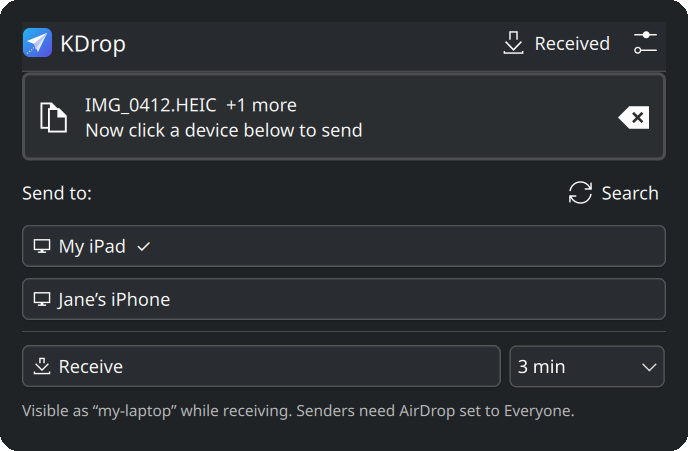
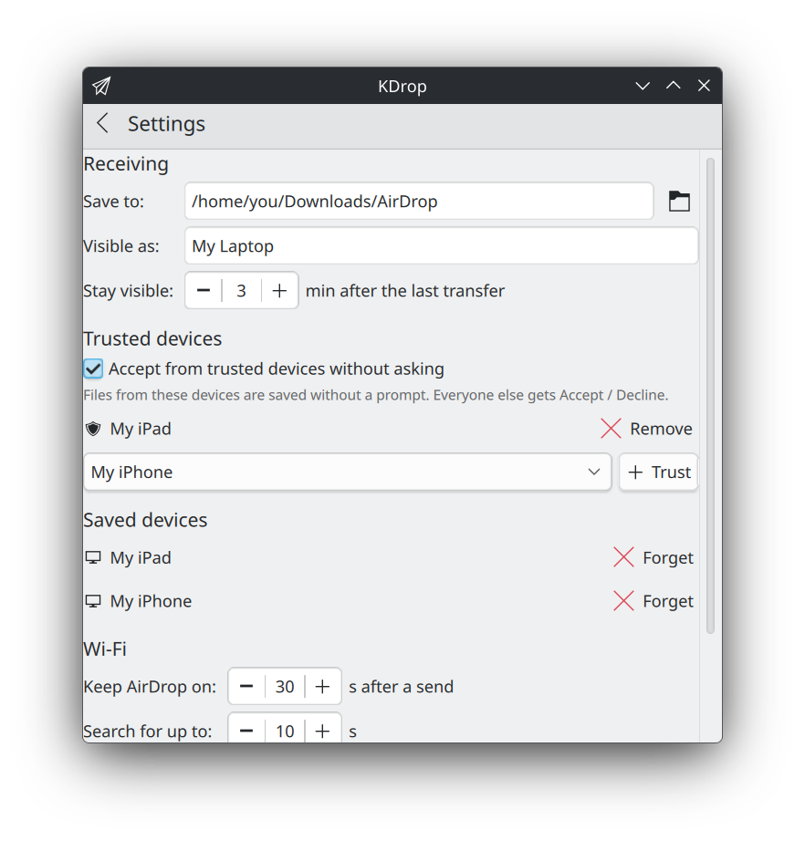

# KDrop

**AirDrop for KDE Plasma** (and other Linux desktops). A panel widget for sending files to and receiving files from iPhone, iPad and Mac, using real AirDrop, with no app on the Apple device.

<p>
  
  
</p>

KDrop is a front end for [**owly**](https://github.com/t4t5/owly), which implements Apple's AWDL radio link and the AirDrop protocol on Linux. owly does the hard part. KDrop makes it a two-click job and keeps Wi-Fi interruptions as short as possible.

## Features

- **Send:** drop files on the panel icon (or click to pick them), then click the device to send to. Folders are zipped automatically. Progress and results appear in the popup and as notifications.
- **Explicit receivers only:** KDrop never sends to "whoever answers first". You pick the device every time, and if a different device answers than the one you picked, the send is cancelled before anything is offered.
- **Receive:** one click makes your PC visible, for 30 seconds up to 30 minutes (pick it next to the button). Each incoming transfer asks **Accept / Always accept from this device / Decline**. Received files get *Open* and *Show in folder* actions.
- **Trusted devices:** your own devices can skip the prompt. Manage the list in Settings.
- **File manager integration:** right-click any file → *Send via AirDrop* → your device. Works in Dolphin (KDE), Files (GNOME), Nemo (Cinnamon) and Caja (MATE).
- **Widget or app:** on Plasma, KDrop runs as a panel widget or as a normal app window (app menu, tray icon while open). Switch in Settings.
- **Not only Plasma:** on GNOME and other desktops, KDrop adds *Find devices* and *Receive files* to the app menu and reports progress as notifications. See [Other desktops](#other-desktops).
- **Short Wi-Fi interruptions:** on most cards AirDrop and Wi-Fi can't run at once, so KDrop turns the AirDrop radio on only for the transfer and gives the card back to NetworkManager immediately. See [Wi-Fi cards and interruptions](#wi-fi-cards-and-interruptions).
- **Works anywhere:** AirDrop is a direct device-to-device link. It doesn't go through your network, so it works on eduroam, hotel and café Wi-Fi, or with no network at all.

## Requirements

- Linux with systemd. KDE Plasma 6 for the panel widget; other desktops work too (see [Other desktops](#other-desktops))
- [owly](https://github.com/t4t5/owly) installed (`owly doctor` should say `ready`)
- A Wi-Fi card owly supports: most recent Intel cards and many Realtek and MediaTek cards. Some keep Wi-Fi connected, others drop it briefly; see [Wi-Fi cards and interruptions](#wi-fi-cards-and-interruptions)
- Python 3 and `notify-send`, plus `kdialog` (KDE) or `zenity` (GNOME and most others) for the accept prompt. All are usually preinstalled
- On the Apple device: AirDrop set to **Everyone for 10 minutes** when it should see your PC, or when you send to it

## Install

1. Install owly. Packages exist for Fedora (44+), Debian 12 / Ubuntu 22.04 and newer, Arch (AUR) and NixOS:

   ```sh
   sudo dnf install ./owly-*.x86_64.rpm      # Fedora, from https://github.com/t4t5/owly/releases
   sudo apt install ./owly_*_amd64.deb       # Debian/Ubuntu, same page
   yay -S owly                               # Arch
   owly doctor                               # should end with "ready"
   ```

   NixOS and building from source: see [owly's README](https://github.com/t4t5/owly#install).

   If you use firewalld, step 2 offers to set this up for you. To do it by hand, let AirDrop in on the AirDrop interface only:

   ```sh
   sudo firewall-cmd --permanent --new-zone=awdl
   sudo firewall-cmd --permanent --zone=awdl --add-interface=awdl0
   sudo firewall-cmd --permanent --zone=awdl --add-port=8771/tcp
   sudo firewall-cmd --permanent --zone=awdl --add-service=mdns
   sudo firewall-cmd --reload
   ```

2. Install KDrop (per user, no root):

   ```sh
   git clone https://github.com/erdeemaydin/kdrop.git
   cd kdrop
   ./install.sh
   ```

3. That's it. On Plasma, `install.sh` puts KDrop in your panel; click its icon to start. On other desktops, see [Other desktops](#other-desktops).

To update, `git pull && ./install.sh`, then `systemctl --user restart plasma-plasmashell`.
To remove, run `./uninstall.sh`.

## Usage

| | |
|---|---|
| **Find your devices** | Set AirDrop on the iPhone/iPad to *Everyone for 10 minutes*, then press **Search**. Found devices are saved. |
| **Send** | Drop files on the icon or popup → click the device. |
| **Receive** | Pick how long (30 s – 30 min) next to **Receive** and press it, then on the Apple device choose your PC in the AirDrop share sheet. The time restarts after each transfer. |
| **From the file manager** | Right-click files → *Send via AirDrop* → device (Dolphin, Files, Nemo, Caja). |
| **Settings** | The ⚙ button opens the settings window. Changes apply when you press **Save**. Under *Run KDrop as* you choose between panel widget and separate app. |
| **Stop / restart** | Right-click the widget → *Stop AirDrop & Reconnect Wi-Fi* or *Restart KDrop* |
| **Command line** | `kdrop send --to "My iPad" photo.jpg`, `kdrop receive 30s`, `kdrop browse`, `kdrop stop`, `kdrop restart`, `kdrop --help` |

## Wi-Fi cards and interruptions

AirDrop needs the Wi-Fi card itself, so whether your normal Wi-Fi keeps working during a transfer depends on the card. owly runs each card in one of two ways:

| owly mode | What happens to your Wi-Fi | Cards (tested by owly) |
|---|---|---|
| **Shared** | **Stays connected the whole time.** AirDrop runs next to your normal connection. Your access point has to be on channel **6, 44 or 149**. | MediaTek MT7925 · Realtek RTL8851BE, RTL8852AE, RTL8852BE, RTL8852CE · Qualcomm Atheros AR9287 |
| **Exclusive** | **Drops briefly.** Wi-Fi is off while AirDrop is on and reconnects afterwards. | Every Intel card that works (9260, 9560, AX200, AX201, AX210, AX211, BE200, BE Panther Lake) · Realtek RTL8822BE, RTL8922AE · MediaTek MT7612U (USB) |
| **Not working (yet)** | AirDrop doesn't work. | Qualcomm WCN6855 and WCN7850 · Intel AC 7265, 8260, 8265 · Realtek RTL8821CE, RTL8821AU |

The list changes with each owly release. [owly's hardware table](https://github.com/t4t5/owly#supported-hardware) is the current one. To see what *your* card does, run:

```sh
owly doctor      # prints the mode and anything in the way, e.g. the access point's channel
```

### On exclusive cards

KDrop keeps the gap as short as it can:

- The radio starts when you click a device, Search or Receive, not before, and stops as soon as the job is done.
- A search ends as soon as devices have answered, instead of running its full time.
- **Keep AirDrop on** (Settings) leaves the radio up for N seconds after a send, so several sends in a row share one reconnect. It's off by default.
- The widget shows *Reconnecting Wi-Fi…* until NetworkManager is back.

What's left is NetworkManager reconnecting, which KDrop can't speed up. Measured on eduroam with an AX210: roughly 5 s scanning, 1 s for 802.1X login and 4 s for DHCP, so about 10 s per transfer. On a home network it's usually a few seconds. Downloads, calls and SSH sessions running at that moment will be interrupted.

To avoid the gap completely on an exclusive card, plug in a supported **USB Wi-Fi adapter** and let owly use it for AirDrop while the built-in card stays connected (see owly's README, *Modes*).

## Other desktops

The Plasma widget is the easiest way to use KDrop, but everything also works without it. On GNOME, Cinnamon, MATE, Xfce and others, `install.sh` adds:

| | |
|---|---|
| **KDrop: Find devices** (app menu) | Looks for nearby devices and saves them. A notification shows what was found. |
| **Send** | Right-click files → *Send via AirDrop* → device. In GNOME Files it's under *Scripts*. |
| **KDrop: Receive files** (app menu) | Makes your PC visible (3 minutes by default). Right-click the app icon for 30 s, 1, 5 or 10 minutes. Each transfer asks Accept / Always accept / Decline in a dialog. |

Everything else (progress, results, errors) arrives as notifications. Settings are changed with `kdrop set` (`kdrop settings` shows them all):

```sh
kdrop set receive_seconds 2m      # default receive time: 30s, 2m, 1m30s …
kdrop set theme dark              # dialog colours: system (default), dark or light
kdrop set dir ~/Downloads         # where received files go
```

**Dark mode:** the accept dialog follows your desktop's dark/light setting automatically. If it doesn't match (for example because a custom GTK theme forces light colours), choose with `kdrop set theme dark` or `light`. On Plasma, the widget and its dialogs follow your Plasma colour scheme.

Xfce's Thunar has no menu file KDrop can generate. Add a custom action there by hand (*Edit → Configure custom actions*) with the command `kdrop send --to "Device name" %F`.

## How it works

```
Plasma widget (QML) ───┐
File manager menus ────┤
App menu (non-Plasma) ─├─▶ kdrop (Python helper) ─▶ owly CLI ─▶ owlyd (system service, AWDL radio)
Command line ──────────┘        │
                                └─ runs each job as a systemd user unit, so transfers survive
                                   Plasma restarts; the radio unit has a 30-minute hard limit
                                   so Wi-Fi always comes back
```

Settings live in `~/.config/kdrop.json`.

## Security notes

- KDrop sends only to a device name you clicked, and checks the name of the device that actually answers.
- Incoming transfers always ask unless the sender is on your trusted list. Device names are not authenticated by AirDrop's *Everyone* mode, so only trust names that are unlikely to be imitated, and remember a trusted name is a convenience, not strong security.
- The receive window closes by itself after a few minutes of inactivity.

## Credits and legal

- [owly](https://github.com/t4t5/owly) by t4t5: the AWDL and AirDrop implementation KDrop depends on (MIT).
- AWDL and AirDrop on Linux were first made possible by the research behind [OWL](https://github.com/seemoo-lab/owl) and [OpenDrop](https://github.com/seemoo-lab/opendrop) (Secure Mobile Networking Lab, TU Darmstadt).

KDrop is an independent project. It is not affiliated with, endorsed by or sponsored by Apple Inc. or KDE e.V. AirDrop, iPhone, iPad and Mac are trademarks of Apple Inc. KDE and Plasma are trademarks of KDE e.V.

## License

[MIT](LICENSE)
